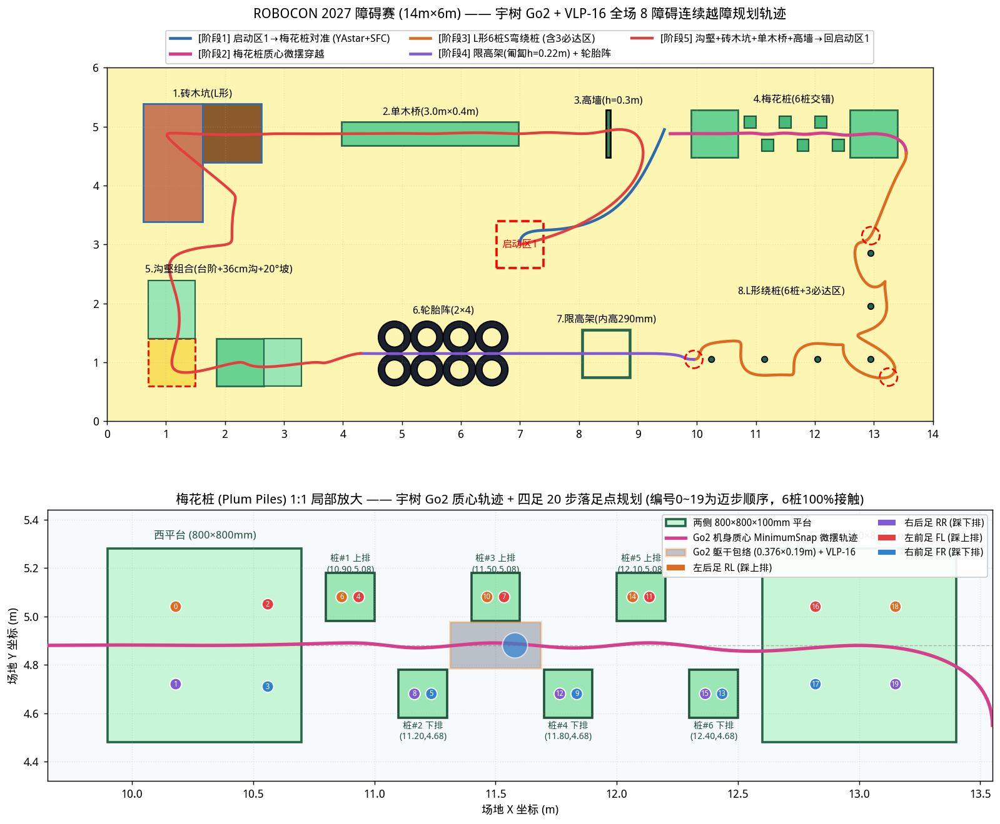
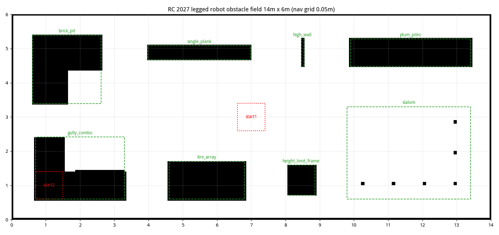
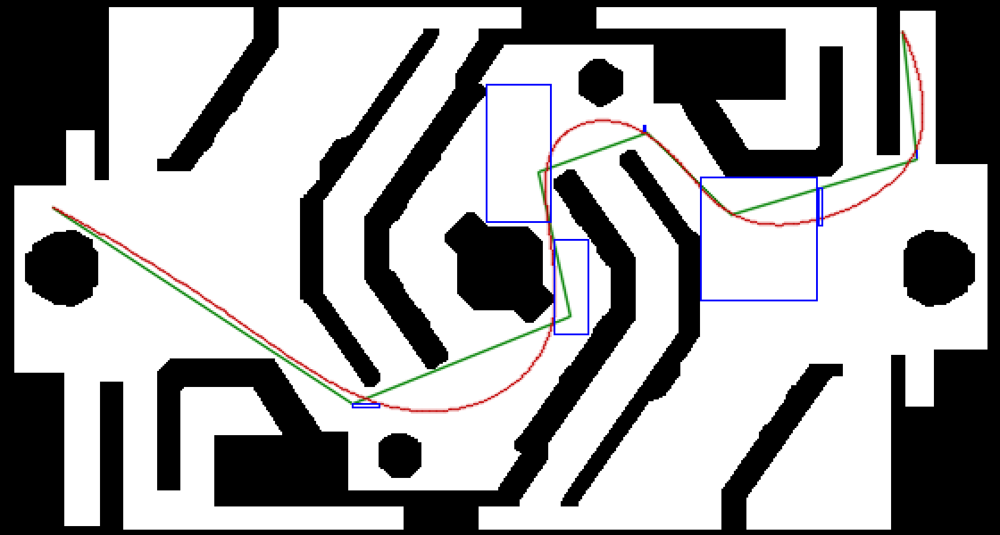
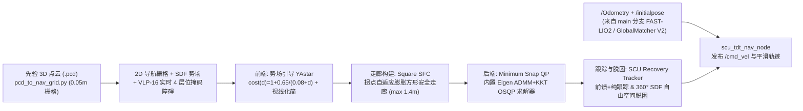

# SCU-TDT-V1 决策规划、轨迹优化与足式越障仿真套件

[](https://docs.ros.org/en/humble/)
[](https://isocpp.org/)
[](#)
[](#)

> 隶属仓库 [`WGK1005/SLAM`](https://github.com/WGK1005/SLAM) 的 **`planning`** 分支（感知前端与无先验重定位请见 [`main`](https://github.com/WGK1005/SLAM/tree/main) 分支）。

面向实验室实机底盘（**VLP-16 + HI12 IMU + 香橙派 4 Pro**）及 **ROBOCON 2027 足式障碍赛 / RMUC** 场景的完整运动规划套件，集成 **势场引导 YAstar 前端搜索**、**方形安全走廊（Square SFC）+ 零外部依赖 Eigen ADMM Minimum Snap 轨迹优化** 与 **SCURM 向自由空间智能脱困跟踪器**。

---

## 📸 规划与仿真效果展示

### 1. ROBOCON 2027 足式障碍赛（14m × 6m）全场 8 障碍连续规划与梅花桩落足点
> 覆盖砖木坑、单木桥、高墙、梅花桩（四足 20 步落足点规划）、L 形绕桩、限高架、轮胎阵与沟壑组合，实现全局连贯越障轨迹与质心微摆控制。



| ROBOCON 2027 1:1 障碍赛导航栅格图 | RMUC 对抗赛势场 A* + Minimum Snap 轨迹对比 |
| :---: | :---: |
|  |  |

---

## 🏗️ 规划与控制流水线



---

## ✨ 核心模块说明

| 模块层级 | 核心源码文件 | 功能与工程特点 |
| :--- | :--- | :--- |
| **点云转导航栅格** | [`tools/pcd_to_nav_grid.py`](tools/pcd_to_nav_grid.py) | 自动读取 3D 先验地图 `.pcd`，截取离地 `[0.22m, 1.85m]` 建筑与实验台障碍，生成 `0.05 m` 分辨率 2D 导航栅格图（`maps/lab_map_1021.pgm`）。 |
| **前端势场规划** | [`src/YAstar/yastar.cpp`](src/YAstar/yastar.cpp)<br/>[`src/YAstar/kinodynamicAstar.cpp`](src/YAstar/kinodynamicAstar.cpp) | 基于快速符号距离场（SDF）构造人工势场 $\text{cost}(d) = 1 + \frac{0.65}{0.08 + d}$，引导路径居中通行；内置 4 层 64 位位掩码注入动态点云障碍，并结合 DP + 视线碰撞检测快速化简拐点。 |
| **后端轨迹优化** | [`src/MinimumSnapOsqp/minimumSnap.cpp`](src/MinimumSnapOsqp/minimumSnap.cpp)<br/>[`src/MinimumSnapOsqp/sfcSquare.cpp`](src/MinimumSnapOsqp/sfcSquare.cpp) | 为化简拐点膨胀生成最大 `1.4 m` 的**方形安全走廊（Square SFC）**，采用内置零外部依赖的 **Eigen ADMM + KKT Polish 二次规划求解器**（[`OsqpEigen.h`](include/OsqpEigen/OsqpEigen.h)）交替迭代碰撞检测，生成无碰撞五阶平滑轨迹。 |
| **脱困与轨迹跟踪** | [`include/scu_tdt_v1/scu_recovery_tracker.hpp`](include/scu_tdt_v1/scu_recovery_tracker.hpp) | 融合 **Toward-Free-Space Recovery**：贴障或受阻时扫描 360° SDF 梯度朝最开阔自由空间撤离；内置前馈 + 纯跟踪速度控制器（适配 `1.2 m/s` 室内安全限速，支持差速与全向底盘）。 |
| **ROS 2 实时节点** | [`src/scu_tdt_nav_node.cpp`](src/scu_tdt_nav_node.cpp) | 订阅 `/Odometry`、`/initialpose`、`/velodyne_points_norm` 与 `/goal_pose`（RViz2 `2D Goal Pose`），实时输出 `/cmd_vel`。 |
| **赛场仿真与建模** | [`tools/generate_rc_obstacle_world.py`](tools/generate_rc_obstacle_world.py)<br/>[`urdf/unitree_go2_vlp16.urdf.xacro`](urdf/unitree_go2_vlp16.urdf.xacro) | 一键生成 ROBOCON 2027（14m×6m）与 RMUC 2025 Gazebo 世界、导航栅格及搭载 VLP-16 的宇树 Go2 / 哨兵 URDF 模型。 |

---

## 📂 目录结构

```text
SCU-TDT-V1/
├── CMakeLists.txt / package.xml       # ROS 2 (scu_tdt_v1) 构建配置
├── config/scu_tdt_params.yaml         # 实机导航与控制器参数
├── include/
│   ├── OsqpEigen/OsqpEigen.h          # 零外部依赖 Eigen ADMM QP 求解器封装
│   └── scu_tdt_v1/scu_recovery_tracker.hpp
├── src/
│   ├── YAstar/                        # 势场 YAstar 与 Kinodynamic A*
│   ├── MinimumSnapOsqp/               # Square SFC 与 Minimum Snap 轨迹优化
│   ├── scu_tdt_nav_node.cpp           # ROS 2 实时规划与跟踪节点
│   └── orig_demo_main.cpp             # 原生算法离线测试入口
├── launch/                            # gazebo_rc_obstacle / gazebo_rmuc_sim 启动文件
├── urdf/                              # Unitree Go2 + VLP-16 / 哨兵 Xacro 模型
├── maps/ & worlds/                    # 实验室、ROBOCON 2027、RMUC 地图与 Gazebo 世界
├── tools/                             # 点云转栅格、一键仿真、越障规划与可视化脚本
└── doc/                               # 算法原理文档 (Astar / MinimumSnap / Usage)
```

---

## 🚀 快速开始

### 1. 实验室实机地图离线规划测试（自动出图）
```bash
bash tools/run_scu_tdt_v1.sh
# 或指定任意全局起终点坐标 (米)
bash tools/run_scu_tdt_v1.sh --start 0.031 0.063 --goal -1.10 9.60
```

### 2. ROBOCON 2027 足式障碍赛规划与 Gazebo 仿真
```bash
# 运行宇树 Go2 全场 8 障碍越障 + 梅花桩四足落足点规划并出图
bash tools/run_gazebo_rc.sh --plan-obstacles

# 启动 1:1 Gazebo 赛场 + RViz2 交互导航 (使用 2D Goal Pose 指点)
bash tools/run_gazebo_rc.sh
```

### 3. 编译并运行 ROS 2 实机导航节点
```bash
source ~/fast_lio_ws/ros_env.sh
colcon build --cmake-args -DCMAKE_BUILD_TYPE=Release
source install/setup.bash
ros2 run scu_tdt_v1 scu_tdt_nav_node --ros-args --params-file config/scu_tdt_params.yaml
```

---

## 📖 详细文档

- [YAstar 势场搜索原理](doc/Astar.md)
- [Minimum Snap 与方形安全走廊优化](doc/MinimumSnap.md)
- [原始使用说明](doc/Usage.md)
