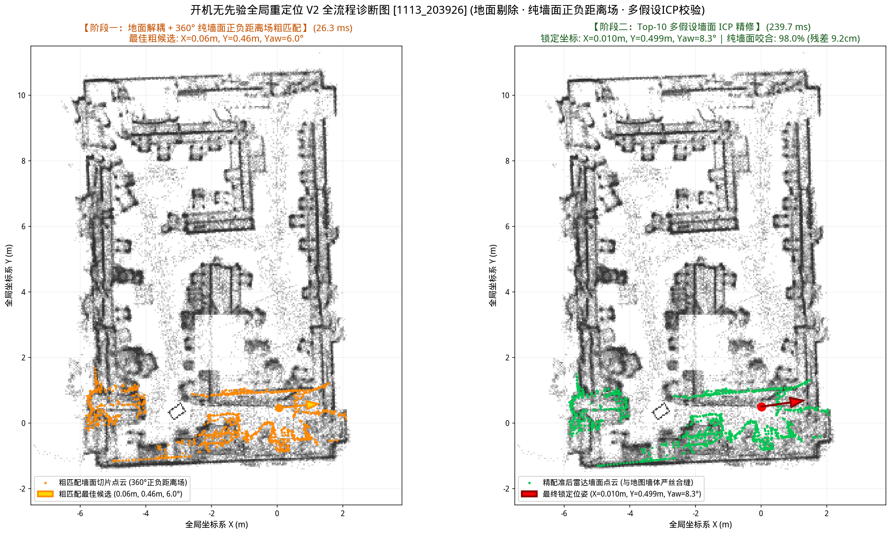
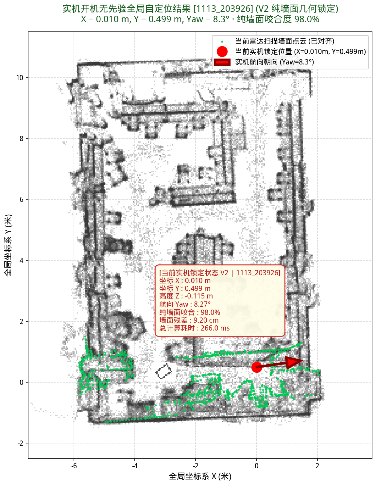
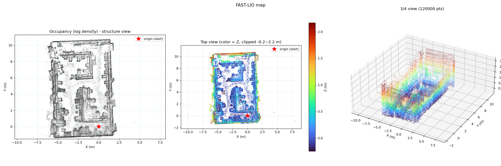
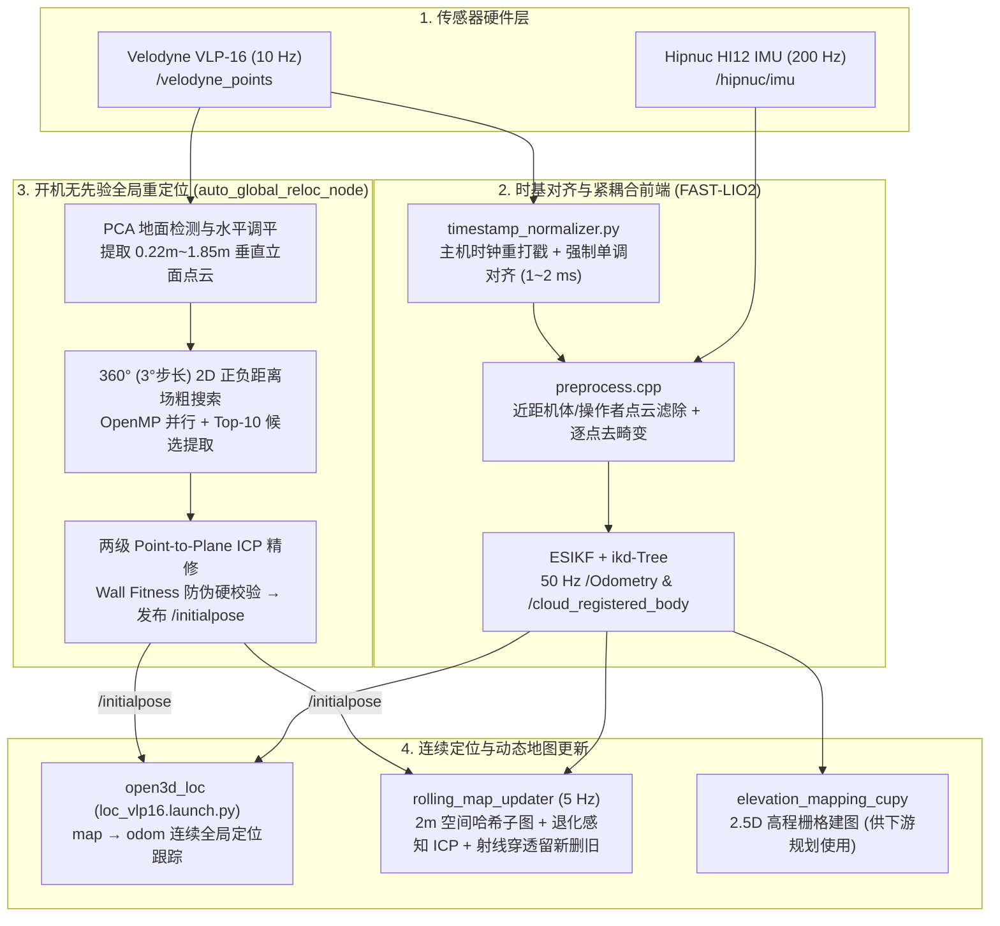

# LiDAR-Inertial SLAM, Zero-Prior Global Relocalization & Dynamic Rolling Map

[](https://docs.ros.org/en/humble/)
[](https://isocpp.org/)
[-orange)](#)
[](#)
[](#)

面向移动机器人与边缘计算平台（**Orange Pi 4 Pro / ARM64** & **x86_64**）的端到端 **3D 激光惯导感知系统**。基于 **Velodyne VLP-16** 与 **Hipnuc HI12 IMU**，实现从无硬件对时下的时基同步、抗遮挡紧耦合建图（FAST-LIO2）、**开机无先验 360° 全局冷启动重定位**，到**5Hz 滚动体素地图“留新删旧”在线更新**及 **2.5D 高程建图**的完整感知闭环。

---

## 📸 实机效果展示

### 1. 开机无先验全局重定位 V2（冷启动两阶段诊断与实机锁定）
> 无需人工在 RViz 中指定初始位姿，系统在开机接管第一帧扫描后全自动完成地面解耦、360° 距离场粗搜索与多假设 Point-to-Plane ICP 精修：实机测试总耗时 **266.0 ms**（粗匹配 `26.3 ms` + 精修 `239.7 ms`），纯墙面咬合度 **98.0%**，墙面残差 **9.20 cm**。

| 两阶段全局重定位全流程诊断 | 实机全局定位最终锁定结果 |
| :---: | :---: |
|  |  |

### 2. FAST-LIO2 激光惯导三维建图效果
> 经过主机时基重打戳对齐与近距操作者点云滤除后，静态建图漂移控制在 **0.007 m** 量级，输出结构清晰的稠密建筑三维点云地图。



---

## 🏗️ 系统架构与数据流



---

## ✨ 核心模块与工程亮点

### 1. 无硬件对时下的多传感器时基同步与前端抗干扰（`FAST_LIO` & `tools`）
- **解决激光时钟跳变痛点**：针对 VLP-16 无 GPS/PPS 时依赖内部晶振导致的时间戳倒退问题（实测 `100 s` 内倒退 `6` 次，最大倒退 `-1748 ms`），自研 [`tools/timestamp_normalizer.py`](tools/timestamp_normalizer.py) 基于主机时钟与扫描跨度重打戳并强制单调递增，彻底消除 `lidar loop back, clear buffer` 丢帧，将雷达-IMU 时基偏差收敛至 **1~2 ms**。
- **近距人体/机体点云滤除**：在 [`src/FAST_LIO/src/preprocess.cpp`](src/FAST_LIO/src/preprocess.cpp) 中新增空间几何掩码（`x < 0.20 m && r < 1.15 m`），在线剔除手持/支架及操作者遮挡点云，并针对台阶与室内走廊场景调优体素参数（[`velodyne.yaml`](src/FAST_LIO/config/velodyne.yaml)）。

### 2. 开机无先验全局自定位 V2（`open3d_loc`）
- **地面解耦与纯立面特征提取**：针对室内地面点占比高、对称走廊易局部极小值误匹配的问题，在 [`global_matcher.cpp`](src/open3d_loc/src/open3d_registration/global_matcher.cpp) 中通过 Z 轴最低点栅格直方图与 **PCA 平面拟合**完成重力水平对齐，剥离地面仅保留 `[0.22 m, 1.85 m]` 垂直立面点云。
- **360° 距离场粗搜 + 多假设 ICP 防伪校验**：构建 2D 正负惩罚距离场进行 120 个航向角（3° 步长）OpenMP 并行搜索，筛选 Top-10 候选执行两级 Point-to-Plane 3D ICP 精修，并以**纯墙面咬合度（Wall Fitness）**与残差进行防伪硬校验，通过 [`auto_global_reloc_node.cpp`](src/open3d_loc/src/auto_global_reloc_node.cpp) 自动发布 `/initialpose` 后退出，释放边缘端算力。

### 3. 滚动体素地图与在线“留新删旧”（`rolling_map_updater`）
- **O(1) 空间哈希滚动子图**：采用 `2.0 m` 空间哈希分块管理 `8 cm` 体素，维持 `24m × 24m` 随机器人移动的活跃窗口，并加入 `min_roll_prior_voxels` 防掏空保护；先验 `.pcd` 地图严格只读。
- **退化感知与多级滑移拉回**：5Hz 局部配准采用 Huber 损失 Point-to-Plane ICP，依据法向量外积特征值比（`λ/λ_max`）在退化方向进行阻尼投影，防止走廊/楼梯沿长轴滑移；配合多指标验收门槛与两级重定位恢复策略。
- **射线穿透“保留新而删旧”**：结合球面距离图射线穿透检查（`ray_clearance_m = 0.35 m`）与 `log_odds` 状态机，连续 `3` 帧稳定命中才保留新静态特征（过滤行人等动态点），同时设置 `0.28 m` 实时回波保护半径与入射角门槛防止误删。

### 4. 2.5D 高程建图与多传感器生态（`elevation_mapping_cupy` & 协同分支）
- 集成 `elevation_mapping_cupy` 与回放脚本，为足式/轮式底盘提供局部地形可通行性高程栅格。
- 本仓库采用多分支模块化组织，覆盖感知、驱动、部署到规划全链路：

| 分支 | 定位 | 核心内容 |
| :--- | :--- | :--- |
| **`main`** *(当前)* | **核心感知工作区** | FAST-LIO2、Open3D 无先验全局重定位、Rolling Map Updater、Elevation Mapping CuPy 与标定/诊断工具集 |
| **`planning`** | **决策与规划** | `SCU-TDT-V1`（YAstar 搜索、MinimumSnap OSQP 轨迹优化、Gazebo 障碍物仿真与导航节点） |
| **`wrl716`** | **雷达驱动扩展** | 万集 WLR-716 激光雷达 ROS 2 驱动、UDP 抓包诊断与 RViz 配置 |
| **`scripts`** | **边缘端运维脚本** | Orange Pi 4 Pro 免密同步、地图与定位结果图一键拉取脚本 |

---

## 📂 仓库目录结构

```text
fast_lio_ws/
├── README.md                          # 项目总览（本文件）
├── SETUP_X86.md                       # x86_64 / Ubuntu 22.04 依赖与编译指南
├── PC_TEST_RUNBOOK.md                 # VLP-16 + HI12 实机测试与验收手册
├── setup_x86.sh / check_env.sh        # 一键环境部署与自检脚本
├── ros_env.sh                         # 环境变量清理与工作区加载（防 WSL/多工作区污染）
├── replay_pure_pointcloud.sh          # 纯点云离线回放脚本
├── docs/
│   ├── fastlio_mapping_and_reloc_guide.md  # 技术原理深析与数学推导（含数据流与参数表）
│   └── assets/                             # 实机建图与重定位可视化成果图
├── src/
│   ├── FAST_LIO/                      # 改造版 FAST-LIO2（带时间同步接入与人体点云滤除）
│   ├── open3d_loc/                    # Open3D 连续定位与 V2 无先验全局重定位节点
│   ├── rolling_map_updater/           # 自研 C++17 滚动体素地图配准与留新删旧更新模块
│   ├── elevation_mapping_cupy/        # GPU 加速 2.5D 高程建图
│   └── products/                      # HI12 IMU 驱动与协议资源
└── tools/
    ├── timestamp_normalizer.py        # 雷达主机时钟重打戳与单调递增对齐节点
    ├── run_mapping.sh                 # 一键启动实时建图
    ├── run_global_reloc.sh            # 一键启动开机无先验全局自定位
    ├── run_rolling_map.sh             # 滚动体素地图配准与留新删旧演示脚本
    ├── run_elevation_replay.sh        # 高程建图回放脚本
    ├── test_global_reloc.cpp          # 全局重定位离线压测工具
    ├── plot_reloc_result.py           # 全局重定位双图诊断可视化生成脚本
    └── scan_time_offset.py / set_extrinsic.py  # 雷惯时间偏移与外参标定工具
```

---

## 🚀 快速开始

### 1. 环境准备与编译
> 详细依赖安装见 [`SETUP_X86.md`](SETUP_X86.md)，每次开启新终端建议先执行 `source ros_env.sh` 隔离环境变量。

```bash
# 1) 安装依赖（Ubuntu 22.04 + ROS 2 Humble，可选清华源）
bash setup_x86.sh --mirror tuna

# 2) 加载纯净 ROS 2 环境并编译核心感知包
source ~/fast_lio_ws/ros_env.sh
colcon build --symlink-install --packages-select fast_lio open3d_loc rolling_map_updater
source install/setup.bash
```

### 2. 实机建图（VLP-16 + HI12 IMU）
```bash
# 终端 1：启动雷达、IMU 驱动与时间规范化节点
source ~/fast_lio_ws/ros_env.sh
ros2 launch fast_lio velodyne_hi12_bringup.launch.py start_imu:=true imu_port:=/dev/ttyUSB0 rviz:=true

# 终端 2：启动一键建图
bash ~/fast_lio_ws/tools/run_mapping.sh

# 建图完成后保存三维先验地图（输出至 ~/maps/）
ros2 service call /map_save std_srvs/srv/Trigger
```

### 3. 开机无先验全局重定位与连续定位
```bash
# 一键冷启动无先验全局自定位（发布 /initialpose 后自动退出）
bash ~/fast_lio_ws/tools/run_global_reloc.sh --map ~/maps/map_1021_1050.pcd

# 接续启动连续全局定位跟踪（维护 map -> odom -> base_link TF 树）
ros2 launch open3d_loc loc_vlp16.launch.py map_file:=$HOME/maps/map_1021_1050.pcd
```

### 4. 滚动地图配准与在线“留新删旧”回放演示
```bash
# 只读加载先验地图，在 24m×24m 滚动窗口内实时配准并更新动态新增/消失障碍
bash ~/fast_lio_ws/tools/run_rolling_map.sh ~/bags/pi_1021_1050 ~/maps/map_1021_1050.pcd
```

### 5. 运行核心模块单元测试
```bash
./install/rolling_map_updater/lib/rolling_map_updater/test_rolling_keep_new_delete_old
```

---

## 📖 延伸文档

- 📘 **技术原理与代码深析**：[`docs/fastlio_mapping_and_reloc_guide.md`](docs/fastlio_mapping_and_reloc_guide.md)（包含 Point-to-Plane ICP 雅可比推导、正负距离场机制与核心代码逐段讲解）
- 🛠️ **环境搭建指南**：[`SETUP_X86.md`](SETUP_X86.md)
- 🧪 **实机联调与验收手册**：[`PC_TEST_RUNBOOK.md`](PC_TEST_RUNBOOK.md)
