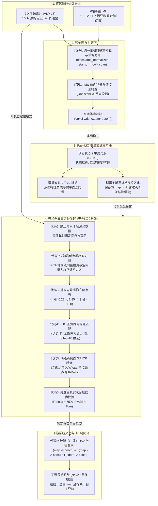

# 复刻Fast-LIO2 激光惯导建图与全局重定位技术方案

---

## 1. 系统概述与整体架构


1. **先验地图构建阶段（Mapping）**：利用 3D 激光雷达（LiDAR）与惯性测量单元（IMU）紧耦合，在移动过程中实时消除运动畸变、递推高精度位姿轨迹，并构建环境的稠密三维几何点云地图（`.pcd`）。
2. **开机全局重定位阶段（Global Relocalization）**：在机器人重新通电或冷启动时，在没有任何初始位姿先验输入（零初值、全图未知位置、未知航向角）的前提下，通过环境几何特征与先验地图匹配，计算出机器人在全局地图坐标系（`map`）下的绝对位姿 $(X, Y, Z, \text{Yaw}, \text{Pitch}, \text{Roll})$，建立 `map -> odom` 的坐标变换，使下游导航规划系统无缝工作。

---

## 2. 通用核心基础知识点详析

### 2.1 时间戳（Timestamp）与时间域对齐方式（软硬件多重对齐机制）
* **概念定义**：时间戳是每个传感器数据包在采集或生成时打上的绝对时间标记（通常精确到纳秒或微秒）。
* **物理意义**：
  * **采样频率不对等**：激光雷达扫描通常为低频（如 10Hz，每隔 100ms 一帧），而 IMU 为高频（如 100Hz~200Hz，每隔 5~10ms 一个数据点）。
  * **对齐机制**：算法根据两个传感器数据包的时间戳，利用线性插值或积分，精确解算出任意激光点发射瞬间的 IMU 角速度与线加速度，从而完成时间域的数据融合。

* **★ 核心对齐方式 1：统一主机时钟重打戳与单调时间对齐（Host-Clock Normalization & Monotonic Alignment）**
  * **背景痛点**：在没有配置昂贵外部硬件 GPS/PPS 硬件对时的情况下，激光雷达依靠内部自由振荡的硬件晶振走时，而 IMU 依靠上位机（香橙派/工控机）系统时钟走时。两者各自独立运行，会导致严重的**时钟漂移与时间倒退**。实测在 100 秒内，雷达时间戳会发生 6 次跳变倒退（最大倒退达 $-1748\text{ ms}$）。后果是 Fast-LIO 频繁触发 `lidar loop back, clear buffer`，丢弃点云缓存，导致建图错位甚至完全崩溃。
  * **对齐实现方式**：系统通过 `timestamp_normalizer` 节点介入数据链路，采用**三步无状态重打戳与单调对齐**：
    1. **提取单帧扫描跨度**：读取当帧点云内部所有点的相对时间最大值 $\text{span} = \max(t_i) \approx 0.1\text{s}$（一圈扫描耗时）；
    2. **反推扫描起始时刻**：根据香橙派主机收到该帧点云的瞬时系统时间 $t_{\text{host}}$，倒推其起始扫描时刻：
       $$\text{header.stamp} = t_{\text{host}} - \text{span}$$
    3. **强制单调递增对齐**：若当前帧推算出的时间戳小于上一帧，强制将其校正为 `上一帧时间戳 + 1ms`，彻底消除时间倒退。
    * **达成的效果**：由于 IMU 数据本身由主机驱动接收打戳，经过该对齐处理后，**激光雷达与 IMU 被强行锁定在同一主机纳秒级基准时钟下**，两者的时钟偏差从 1.7 秒的动态跳变压缩到小于 $1\sim 2\text{ms}$ 的固定微小延迟，为后续去畸变提供了坚实基础。

* **★ 核心对齐方式 2：驱动级首包对齐（First Packet Stamping）**
  * **机制**：在雷达驱动层强制开启 `timestamp_first_packet: true`。若采用默认的“尾包对齐”，点云首部的激光点相对时间戳会计算为负数，导致去畸变算法的积分方向彻底反向。开启首包对齐后，点云内部每个点的相对时间偏移恒定满足 $t_{\text{point}} \in [0.0, 0.1]\text{s}$。

类似于我在主机建了一个一直往前跑的计时器，我将雷达与imu的时间与之匹配 


### 2.2 激光雷达运动去畸变（Motion Undistortion / Deskewing）
* **畸变起因**：机械旋转式激光雷达（如 16 线 VLP-16）旋转一周耗时约 100ms。在此期间，小车若以 $1\text{ m/s}$ 的速度移动或发生旋转，雷达这一圈开始发射的点与最后发射的点并不是在同一个空间位置采样的，导致原本平直的墙面被拉扯成弧形或斜面（称为“果冻效应”或运动畸变）。
* **去畸变过程**：
  1. 读取雷达点云中每个点记录的微秒级相对时间偏移（Offset Time）。
  2. 结合该时间段内 IMU 高频积分推算的小车轨迹。
  3. 将每个激光打在物体上的点通过刚体变换插值，全部反向投影到“该帧雷达扫描结束时的统一坐标原点”，恢复物体真实的静态几何轮廓。

### 2.3 机器人坐标系体系与静态外参（TF & Extrinsic Calibration）
* **四大核心坐标系**：
  * **`lidar_link`（雷达系）**：以激光雷达发射中心为原点的局部三维坐标系。
  * **`base_link` / `body`（车体/IMU系）**：小车的几何运动中心（通常贴合 IMU 安装位置）。
  * **`odom`（里程计局部参考系）**：单次开机通电时以小车初始位置为原点的连续轨迹参考系，连续平滑但累积漂移、重新开机后归零。
  * **`map`（全局地图坐标系）**：整个实验室或作业场地的固定统一世界坐标系。
* **外参（Extrinsics）**：雷达和 IMU 在小车硬件上安装时的刚体相对位姿关系，包含三维平移向量 $\mathbf{p}_{imu}^{lidar}$ 与三维旋转矩阵 $\mathbf{R}_{imu}^{lidar}$。外参不准会导致算法将旋转误判为平移，造成定位发散。

### 2.4 空间体素网格滤波（Voxel Grid Downsampling）
* **原理**：将三维空间划分为大小均匀的立方体体素（如 $0.10\text{m} \times 0.10\text{m} \times 0.10\text{m}$ 网格），落入同一体素内的所有点被合并为一个重心点。在完整保留建筑几何骨架（拐角、平面、立柱）的前提下，过滤密集冗余点，计算量下降 70%~90%。

### 2.5 几何退化分析与地面/立面特征解耦（Ground Decoupling）就是删去地面的绝大部分点云使得特征节点更多的集中于椅子桌子能更具辨识度的物体上
* **退化陷阱**：在室内平坦地面上，大面积的地面点云其表面法向量全部垂直指向天花板（$Z$ 轴）。沿 $X$ 或 $Y$ 平移运动时，地面点云的几何残差几乎为零，导致优化求解器在水平方向缺乏几何梯度，产生沿地面的虚假滑动（退化）。
* **解耦方案**：通过高程直方图与 PCA 自动解算基准地面高度，提取离地面特定高度区间（如 `h ∈ [0.22m, 1.85m]`）且法向量近乎水平（$|\mathbf{n}_z| < 0.5$）的点云，彻底剔除平坦地板，锁定实验台、矮柜、立柱、墙壁等对水平 $(X, Y, \text{Yaw})$ 提供强约束的特征。

### 2.6 点到面 ICP 配准算法全方位详解（Point-to-Plane ICP）

点云配准（Point Cloud Registration）是激光定位中的“临门一脚”，而 **ICP（Iterative Closest Point，迭代最近点算法）** 则是三维几何精修中最核心、应用最广泛的基石算法。

#### 2.6.1 经典点到点 ICP（Point-to-Point）的回顾与缺陷
1992 年由 Besl 和 McKay 提出的经典点到点 ICP 算法，其逻辑非常朴素：
1. **匹配关联**：对当前扫描中的每一个点 $\mathbf{p}_i$，在先验地图 $\mathcal{M}$ 中用 KD-Tree 搜索离它欧几里得距离最近的点 $\mathbf{q}_i$：
   $$\mathbf{q}_i = \arg\min_{\mathbf{q} \in \mathcal{M}} \|\mathbf{R}\mathbf{p}_i + \mathbf{t} - \mathbf{q}\|_2$$
2. **闭式求解**：构建目标函数最小化所有对应点对之间的欧式几何距离平方和：
   $$E(\mathbf{R}, \mathbf{t}) = \sum_{i=1}^N \|\mathbf{R}\mathbf{p}_i + \mathbf{t} - \mathbf{q}_i\|_2^2$$
   该问题可通过点云中心化与对协方差矩阵做奇异值分解（SVD）求得闭式解析解：
   $$\mathbf{H}_{\text{cov}} = \sum_{i=1}^N (\mathbf{p}_i - \bar{\mathbf{p}})(\mathbf{q}_i - \bar{\mathbf{q}})^T = \mathbf{U} \mathbf{\Sigma} \mathbf{V}^T \implies \mathbf{R} = \mathbf{V} \mathbf{U}^T, \quad \mathbf{t} = \bar{\mathbf{q}} - \mathbf{R}\bar{\mathbf{p}}$$
* **致命缺陷**：激光雷达两次扫描打在物体表面的光斑位置是**随机离散分布**的，两次采样的点几乎不可能刚好落在同一个几何微元上。在平坦的大面积墙面或光滑地面上，点到点模型强行把激光点往地图上离散的点上拉扯，导致在切线方向产生虚假的阻力，收敛极其缓慢（往往需要 50~100 次迭代），极易陷入由采样离散性造成的虚假浅凹坑极小值。

---

#### 2.6.2 点到面 ICP（Point-to-Plane）的几何本质与数学推导
为了从根本上消除离散采样误差，Chen 和 Medioni 提出了**点到面 ICP**。
* **物理几何意义**：真实世界中的墙面、桌面与地面都是连续的光滑局部平面。算法不再要求当前点 $\mathbf{p}_i$ 与地图点 $\mathbf{q}_i$ 完全重合，而是**允许 $\mathbf{p}_i$ 在地图点所在的切平面上自由滑动，只严格惩罚沿该处表面法向量 $\mathbf{n}_i$ 垂直方向的穿透或悬空误差**。

##### ① 目标残差定义
给定实时点 $\mathbf{p}_i$，地图最近邻点 $\mathbf{q}_i$ 及其单位表面法向量 $\mathbf{n}_i$（$\|\mathbf{n}_i\|=1$），点到平面的带符号标量距离残差为：
$$r_i(\mathbf{R}, \mathbf{t}) = \left( \mathbf{R}\mathbf{p}_i + \mathbf{t} - \mathbf{q}_i \right) \cdot \mathbf{n}_i$$
系统优化目标为最小化总残差平方和：
$$E(\mathbf{R}, \mathbf{t}) = \sum_{i=1}^N \left[ \left( \mathbf{R}\mathbf{p}_i + \mathbf{t} - \mathbf{q}_i \right) \cdot \mathbf{n}_i \right]^2$$

##### ② 小角度扰动线性化（Lie Algebra & Taylor Approximation）
在单次迭代中，旋转矩阵更新量 $\Delta \mathbf{R}$ 处于局部切空间，可采用李代数微小旋转向量 $\boldsymbol{\omega} = [\omega_x, \omega_y, \omega_z]^T \in \mathfrak{so}(3)$ 作一阶泰勒展开（罗德里格斯公式近似）：
$$\Delta \mathbf{R} \approx \mathbf{I} + [\boldsymbol{\omega}]_\times = \begin{bmatrix} 1 & -\omega_z & \omega_y \\ \omega_z & 1 & -\omega_x \\ -\omega_y & \omega_x & 1 \end{bmatrix}$$
平移增量记为 $\Delta \mathbf{t} = [\Delta t_x, \Delta t_y, \Delta t_z]^T$。变换后的点位置为：
$$\mathbf{p}'_i = (\mathbf{I} + [\boldsymbol{\omega}]_\times)\mathbf{p}_i + \Delta \mathbf{t} = \mathbf{p}_i + \boldsymbol{\omega} \times \mathbf{p}_i + \Delta \mathbf{t}$$

##### ③ 雅可比矩阵（Jacobian）推导
将线性化后的点代入残差公式：
$$r_i(\Delta \mathbf{x}) \approx \left( \mathbf{p}_i + \boldsymbol{\omega} \times \mathbf{p}_i + \Delta \mathbf{t} - \mathbf{q}_i \right) \cdot \mathbf{n}_i = \underbrace{(\mathbf{p}_i - \mathbf{q}_i) \cdot \mathbf{n}_i}_{e_i \text{ (当前几何残差)}} + (\boldsymbol{\omega} \times \mathbf{p}_i) \cdot \mathbf{n}_i + \Delta \mathbf{t} \cdot \mathbf{n}_i$$
根据混合积的轮换对称性 $(\boldsymbol{\omega} \times \mathbf{p}_i) \cdot \mathbf{n}_i = (\mathbf{p}_i \times \mathbf{n}_i) \cdot \boldsymbol{\omega}$，将状态增量提取出来：
$$r_i(\Delta \mathbf{x}) \approx (\mathbf{p}_i \times \mathbf{n}_i)^T \boldsymbol{\omega} + \mathbf{n}_i^T \Delta \mathbf{t} + e_i = \mathbf{J}_i \Delta \mathbf{x} + e_i$$
其中：
* 状态未知量：$\Delta \mathbf{x} = \begin{bmatrix} \boldsymbol{\omega} \\ \Delta \mathbf{t} \end{bmatrix} \in \mathbb{R}^{6 \times 1}$
* 雅可比行向量：$\mathbf{J}_i = \begin{bmatrix} (\mathbf{p}_i \times \mathbf{n}_i)^T & \mathbf{n}_i^T \end{bmatrix} \in \mathbb{R}^{1 \times 6}$

##### ④ 高斯-牛顿（Gauss-Newton）正规方程构建与极速求解
对凸二次目标函数 $\frac{1}{2} \sum r_i^2$ 令其关于 $\Delta \mathbf{x}$ 的偏导为零，得到标准的 $6 \times 6$ 正规方程：
$$\left( \sum_{i=1}^N \mathbf{J}_i^T \mathbf{J}_i \right) \Delta \mathbf{x} = - \sum_{i=1}^N \mathbf{J}_i^T e_i \iff \mathbf{H} \Delta \mathbf{x} = \mathbf{b}$$
* **Hessian 近似矩阵**：$\mathbf{H} = \sum_{i=1}^N \mathbf{J}_i^T \mathbf{J}_i \in \mathbb{R}^{6 \times 6}$（对称正定矩阵）；
* **梯度向量**：$\mathbf{b} = - \sum_{i=1}^N \mathbf{J}_i^T e_i \in \mathbb{R}^{6 \times 1}$。
通过 Cholesky 分解（$LL^T$）即可在微秒级时间内精确求出最佳位姿增量 $\Delta \mathbf{x}$，更新当前变换矩阵：
$$\mathbf{T} \leftarrow \begin{bmatrix} \Delta \mathbf{R} & \Delta \mathbf{t} \\ \mathbf{0}^T & 1 \end{bmatrix} \cdot \mathbf{T}$$
通常仅需 **15 ~ 25 次迭代**，位姿即可高精收敛。

---

#### 2.6.3 三大经典 ICP 变体横向对比

| 算法类型 | 残差几何定义 | 优化数学模型 | 收敛速度 | 对法向量精度的依赖 | 适用场景 |
| :--- | :--- | :--- | :--- | :--- | :--- |
| **经典点到点 (Point-to-Point)** | 点与点之间的欧式直线距离 | SVD 解析闭式解 | 极慢（需要 50~100 次迭代） | **完全不需要**法向量 | 粗糙无规则几何体（如树木、岩石雕塑） |
| **经典点到面 (Point-to-Plane)** | 点到目标切平面的垂直投影距离 | 高斯-牛顿 / LM 线性迭代求解 | **极快（通常 15~25 次即收敛）** | **依赖地图点云法向量** | **室内结构化建筑（墙面、实验台、机柜）** |
| **广义 ICP (Generalized-ICP)** | 点与点局部的协方差椭球马氏距离 | 平面到平面的概率极似然优化 | 快，但单次构建协方差计算量大 | 依赖两帧点云的双向协方差矩阵 | 自动驾驶室外大场景公路 |

---

#### 2.6.4 ICP 的两大工程致命缺陷与系统解决策略

##### 陷阱 1：局部极小值死锁（吸引盆范围极其狭窄）
* **数学本质**：ICP 本质是局部贪心梯度下降算法。当给定的初始位姿误差较大（例如航向角偏差超过 $30^\circ$ 或平移偏差超过 $1\text{m}$）时，KD-Tree 寻找的“最近邻点对”在物理实际上是完全张冠李戴的错误对应关系，算法会沿着错误的梯度一路滑向伪极小值，甚至发生 180° 反向锁死。
* **本系统的破解策略**：**严禁在无先验时裸跑 ICP**！必须通过**阶段一的 360° 全局正负距离场粗匹配**，在全局网格空间以 $3^\circ$ 航向步长进行穷举初筛，将送入 ICP 的候选初值误差收敛至 $\Delta x, \Delta y < 0.20\text{m}, \Delta \text{Yaw} < 3^\circ$，百分之百确保初值落入全局最优解的狭窄“吸引盆（Basin of Attraction）”内。

##### 陷阱 2：几何退化与滑移（Degeneracy & Poor Observability）
* **数学本质**：在平坦地面占主导的室内环境中，所有地面点的法向量全部为 $\mathbf{n} = [0, 0, 1]^T$。
  将这一法向量代入 Hessian 矩阵 $\mathbf{H} = \sum \mathbf{J}_i^T \mathbf{J}_i$：
  $$\mathbf{J}_{i, \text{ground}} = \begin{bmatrix} (\mathbf{p}_i \times [0, 0, 1]^T)^T & 0 & 0 & 1 \end{bmatrix}$$
  可以看到其关于平移 $\Delta t_x$ 与 $\Delta t_y$ 的分量**全部严格为零**！这意味着地面点云在水平方向没有任何约束，Hessian 矩阵在对应方向的特征值接近于 0（条件数极差），导致优化求解器在地面上发生毫无阻力的剧烈“滑移漂移”。
* **本系统的破解策略**：**两级分层 ICP 解耦机制**：
  * **Level 1（纯立面 Point-to-Plane ICP）**：彻底剔除地面点，仅提取法向量横向分布的墙壁、实验台侧板与立柱。立面点拥有大量沿 $X$ 和 $Y$ 方向的丰富法向量分量，在不受平地任何拖累的情况下，以 $0.25\text{m}$ 动态邻域半径将水平 $(X, Y, \text{Yaw})$ 率先锁死；
  * **Level 2（全点云 6-DoF Point-to-Plane ICP）**：此时水平平移和航向已无法再发生滑动，再将地面点重新引入（半径缩减至 $0.20\text{m}$），利用地面在垂向的高信噪比约束，将高程 $Z$ 与倾角 $(\text{Roll}, \text{Pitch})$ 微调至毫米级。

---

#### 2.6.5 动态对应距离衰减与防伪评价指标
在实际工程代码中，配准不能仅看“是否跑完了循环”，还必须辅以严格的动态截断与评价防伪体系：
1. **搜索半径阶梯衰减（Coarse-to-Fine Radius Decay）**：
   - 粗配准阶段设定较大的最大对应距离（`max_correspondence_distance = 0.75m`），容忍初始位姿的微小位移，扩大吸引范围；
   - 精细阶段将搜索半径梯次收缩至 `0.25m` 与 `0.20m`，自动将人走动等环境动态外点（Outliers）排除在点对之外。
2. **严格的收敛准则（Convergence Criteria）**：
   - `relative_fitness = 1e-6`（内点比例变化极小即停）；
   - `relative_rmse = 1e-6`（均方根残差变化极小即停）；
   - `max_iteration = 25`（防止在退化边缘无限振荡消耗 CPU）。
3. **防伪硬指标 —— 纯墙面真实咬合度（Wall Fitness）**：
   - **定义**：精修配准后，激光立面点中落在地图真实表面 $0.10\text{m}$ 范围内的比例：
     $$\text{Wall Fitness} = \frac{\sum_{i=1}^M \mathbb{I}\left( \text{dist}(\mathbf{T}\mathbf{p}_i^{\text{wall}}, \mathcal{M}_{\text{wall}}) \le 0.10\text{m} \right)}{M}$$
   - **防伪阈值**：实测中正确位姿的 Wall Fitness 均在 **$95\% \sim 99.8\%$**，且 Wall RMSE 仅约 **$5 \sim 6\text{ cm}$**；任何局部对称误匹配位姿由于无法吻合全部立面，其咬合率会剧降至 $40\%$ 以下，被系统直接拒绝，实现了极高可靠性的闭环自检。

---

## 3. 重定位特征匹配的核心机制与开源思路演进（重点解析）

移动机器人在冷启动开机（零先验位姿、全图盲测）下的重定位，是 SLAM 工程中最容易出现误配和局部极小值的环节。本系统的全局重定位算法吸纳并升华了经典开源 SLAM 社区（Google Cartographer、AMCL、HDL_localization）的核心思想，设计了一套“**降维全局相关性粗匹配 + 多假设分层 3D 点到面 ICP 精修 + 纯立面防伪硬校验**”的全新架构。

### 3.1 开源思路 1：Google Cartographer 的相关性扫描匹配（Correlative Scan Matching, CSM）与 3D 降维
* **Cartographer 原生思路**：
  在 Google Cartographer 的后端回环检测（Loop Closure）中，为了实现完全不需要初值的全局搜索，采用了 **实时间相关性扫描匹配（CSM）** 与 **分支定界（Branch-and-Bound）** 算法。其本质是在离散的 $(X, Y, \theta)$ 搜索空间中，将激光点云投影到预计算的概率栅格地图上，计算所有激光击中点落在障碍物网格内的概率累加得分，从而在全局范围内搜寻最大响应峰值。
* **本系统的吸收与升维创新**：
  * **难点**：Cartographer 的 CSM 是针对 2D 单线激光设计的；而在 3D 空间中，自由度从 3-DoF 暴增至 6-DoF $(X, Y, Z, \text{Roll}, \text{Pitch}, \text{Yaw})$，点云数量从数百点激增到数万点。如果直接在 3D 体素空间中做无先验穷举扫描匹配，时间复杂度将达到 $\mathcal{O}(N^6)$，在嵌入式端（如香橙派）需要几十分钟甚至数小时，完全不可行。
  * **我们的解决思路**：**“3D 几何特征降维投影”**。利用重力对齐与地面高程估计，机器人开机时的 Pitch、Roll（水平倾角）和高程 $Z$ 可以率先被重力加速度和地面特征确定；此时剩余的全局不确定性完全退化为平面的 $(X, Y, \text{Yaw})$。我们将 3D 空间中经过法向量筛选的高信噪比立面点云，直接压缩映射为 2D 轮廓切片，完美复用了 Cartographer 极速相关性扫描匹配的哲学，**在香橙派 ARM CPU 上将 360° 全图穷举粗匹配压缩至 160 毫秒以内**！

---

### 3.2 开源思路 2：概率机器人学与 AMCL 的似然场模型（Likelihood Field Model）与正负惩罚场
* **AMCL 经典思路**：
  在《Probabilistic Robotics》（Thrun 等著）及 ROS 经典定位包 `amcl` 中，雷达观测模型普遍采用 **似然场模型（Likelihood Field Model）**。相比传统射线投射模型（Beam Model），似然场将地图障碍物通过欧氏距离变换（Distance Transform）模糊化为一个高斯分布平滑场：
  $$p(z_k | \mathbf{x}, m) = z_{\text{hit}} \cdot \frac{1}{\sqrt{2\pi\sigma^2}} \exp\left(-\frac{\text{dist}^2}{2\sigma^2}\right) + \frac{z_{\text{rand}}}{z_{\text{max}}}$$
  这样，只要激光点落在真实障碍物附近，就能获得平滑的距离梯度，具有极强的抗噪性和抗几何微形变能力。
* **本系统的吸收与“正负惩罚场”创新**：
  * **经典缺陷**：传统 AMCL 的似然场数值处处非负（$\ge 0$）。在大型室内环境中，当小车处于未建图的空旷走廊或盲区时，由于没有惩罚项，如果有一两个局部噪点恰好贴合了远处的一段孤立墙面，即便大量激光点打入大片空旷空地，算法依然会给出正向得分，从而产生严重的“虚假全局候选”。
  * **我们的创新**：构建了 **2D 正负距离场查找表（Signed Distance Field LUT）**：
    1. **正响应区（$\text{dist} \le 0.32\text{m}$）**：采用高斯衰减函数赋正分，越贴合墙面得分越高（最大为 $1.0$）；
    2. **死区过渡（$0.32\text{m} < \text{dist} \le 0.45\text{m}$）**：得分为 $0.0$；
    3. **强惩罚区（$\text{dist} > 0.45\text{m}$ 或越界）**：强制给予负惩罚分（`penalty_val = -0.25`）。
  * **物理意义**：该机制相当于同时做“特征击中奖励”与“虚无空间穿透惩罚”。若假设位姿让激光点打进了本该是空旷走廊的区域，总得分会断崖式暴跌，从数学本质上杜绝了伪极大值的生成。

---

### 3.3 开源思路 3：HDL_localization / Open3D 的点到面 ICP 与分层解耦约束
* **HDL_localization / Open3D 经典思路**：
  在知名的 3D 激光定位开源库 `hdl_localization`（Kenji Koide）与 3D 视觉库 `Open3D` 中，三维点云微调主要依赖 **点到面（Point-to-Plane）ICP** 或 **正态分布变换（NDT_OMP）**。点到面 ICP 在每次迭代中将点投影到目标平面的局部法向量上求解最小二乘，收敛半径大、收敛步数极少。
* **本系统的吸收与“两级分层 ICP”策略**：
  * **传统 3D ICP 的室内通病**：在室内环境中，平坦地面点通常占雷达总点数的 50% 以上。如果直接送入标准的 3D 点到面 ICP，优化器会因为地面巨大的权重而产生“沿地面滑移退化”（在平地上滑动几个厘米，点面残差几乎毫无变化），导致收敛后的平移 $(X, Y)$ 和航向 $(\text{Yaw})$ 发生严重漂移。
  * **分级解耦设计**：
    1. **第一级（纯立面 Point-to-Plane ICP）**：彻底剔除地面点，仅输入实验台立面、矮柜侧板和建筑物外墙。在不受任何平地摩擦干扰的前提下，利用立面丰富的法向量变化，在极短的 25 次迭代内将水平 $(X, Y, \text{Yaw})$ 紧紧吸附锁死。
    2. **第二级（全点云 6-DoF Point-to-Plane ICP）**：在水平位姿已经完全锁死的前提下，引入全点云（包含地面）。此时地面点不再是退化源，反而成为绝佳的高程基准，将垂直高程 $Z$ 与水平姿态 $(\text{Roll}, \text{Pitch})$ 进一步锁定至毫米级精度。

---

### 3.4 开源思路 4：多假设跟踪（Multi-Hypothesis Tracking, MHT）与真实咬合度（Wall Fitness）硬校验
* **经典思路**：
  在对称环境（如医院相似病房、大学长走廊、成排排列的实验台）中，贪心的单峰匹配算法极易在阶段一将小车锁死在对称的假位置。经典概率学派采用多假设跟踪（MHT）来维护多条可能的分支。
* **本系统的多假设闭环体系**：
  1. **多峰分支提取**：在阶段一的 360° 距离场扫描中，通过空间网格聚类与非极大值抑制（NMS），提取互不重叠的前 10 个局部极大值候选点（Top-10 Candidates）。
  2. **多分支并行竞争**：利用 OpenMP 多线程，将这 10 个候选位姿并行送入两级 3D ICP 求解器进行收敛微调。
  3. **纯墙面几何咬合度防伪门槛（Wall Fitness Metric）**：
     * 评价指标并非采用全点云重合度（因为地面很容易被误凑出高分），而是专门统计经过 3D 变换后的**纯立面点落在地图真实墙面 $10\text{cm}$ 邻域内的比例**；
     * **判据规则**：硬性要求 $\text{Wall Fitness} \ge 75.0\%$ 且残差均方根 $\text{RMSE} \le 0.08\text{m}$。真实正确位姿在实测中咬合度通常高达 $95\% \sim 99.8\%$，而对称假峰通常会暴露出部分激光点穿透墙面悬空，其立面咬合度跌破 $40\%$，从而被系统直接一票否决。

---

### 3.5 核心方案对比总结表

| 评估维度 | 传统纯开源 3D 定位库（如 hdl_localization / NDT） | 传统 2D 开源定位（如 Cartographer / AMCL） | **本系统融合重定位方案（GlobalMatcher V2）** |
| :--- | :--- | :--- | :--- |
| **开机先验需求** | 必须由外部/人工指定初值（初值误差需 $<1\text{m}, <30^\circ$） | 可全图粗定位，但仅限 2D 平面环境 | **完全零先验冷启动（360° 满圆盲开，任意坐标）** |
| **对地面退化的免疫力** | 极弱，平坦地面容易导致 $(X, Y)$ 滑移漂移 | 不处理 3D 地面，仅取单线切片 | **极强，基于 PCA 与法向量实现地面/立面两级分层解耦** |
| **全图无先验计算耗时** | 3D 空间全图穷举不可行（耗时几十分钟） | 耗时中等（$0.5\text{s} \sim 2\text{s}$） | **极快（香橙派端整流程约 $1.0\text{s}$，WSL 端仅 $300\text{ms}$）** |
| **抗对称环境能力** | 易陷入局部极小值伪锁死 | 单峰更新慢，需运动多帧收敛 | **具备 Top-10 多假设跟踪与纯立面咬合度硬防伪，开机单次即锁定** |
| **最终定位精度** | 厘米级（有良好初值时） | 厘米级（仅平面 3-DoF） | **全自由度高精收敛（平面 $<5\text{cm}$，航向 $<1^\circ$，$Z < 2\text{cm}$）** |

---

## 4. 核心代码深入剖析

本节针对整个工程中最核心的 7 个底层代码段进行逐行解析，展示理论算法如何在实际代码工程中落地。

### 💻 核心代码 0：时间域对齐 —— 统一主机时基重打戳与单调递增对齐
* **源文件路径**：`tools/timestamp_normalizer.py`
* **关键机制**：利用 NumPy 快速向量化提取激光单圈最大时间跨度 `span`，根据香橙派主机到达时刻逆推起始时刻 `stamp = now - span`，并引入 `stamp = self.last_out + 0.001` 强制单调保护，彻底杜绝时间倒退丢帧。

```python
# 摘自 tools/timestamp_normalizer.py 中的核心对齐实现
def _time_span(msg: PointCloud2):
    """读取一帧点云里 time 字段的最大值 (向量化提取，1.7万点耗时仅 1ms)"""
    off = next((f.offset for f in msg.fields if f.name == 'time'), None)
    n = msg.width * msg.height
    need = n * msg.point_step
    # 将二进制点云数据映射为二维数组并提取 float32 类型的相对发射时间
    a = np.frombuffer(bytes(msg.data[:need]), dtype=np.uint8).reshape(n, msg.point_step)
    t = a[:, off:off + 4].copy().view(np.float32).reshape(-1)
    t = t[np.isfinite(t)]
    return float(t.max()) if t.size > 0 else 0.1  # 正常约为 0.1s (10Hz 旋转一圈耗时)

def on_cloud(self, msg: PointCloud2):
    now = self.get_clock().now().nanoseconds * 1e-9  # 香橙派主机当前纳秒级系统时钟

    # 1. 计算单圈时间跨度 span
    span = self._time_span(msg)
    
    # 2. 核心对齐公式：点云是转完一圈才发出的，而 FAST-LIO 要求 stamp 必须是起始时刻
    stamp = now - span

    # 3. 强制单调对齐机制：两帧到达过近或网络微小抖动时，强制递增 1ms，防止时间倒退导致 FAST-LIO 清空缓存
    if self.last_out is not None and stamp <= self.last_out:
        stamp = self.last_out + 0.001
        self.forced += 1
    self.last_out = stamp

    # 4. 重新打包标准 ROS2 时间戳并发布至 /velodyne_points_norm
    sec = int(stamp)
    msg.header.stamp.sec = sec
    msg.header.stamp.nanosec = int((stamp - sec) * 1e9)
    self.pub.publish(msg)
```

---

### 💻 核心代码 1：IMU 运动积分与点云逐点去畸变（Deskewing）
* **源文件路径**：`fast_lio/src/IMU_Processing.hpp`
* **关键机制**：利用点云中每个点自带的时间戳微秒偏移（存于 `curvature` 字段），向后传播插值得到该瞬间的姿态，将每一个激光点逆向投影到帧尾瞬时雷达坐标系。

```cpp
// 摘自 fast_lio/src/IMU_Processing.hpp 中的 UndistortPcl 函数
auto it_pcl = pcl_out.points.end() - 1;
for (auto it_kp = IMUpose.end() - 1; it_kp != IMUpose.begin(); it_kp--)
{
    auto head = it_kp - 1;
    auto tail = it_kp;
    R_imu << MAT_FROM_ARRAY(head->rot);
    vel_imu << VEC_FROM_ARRAY(head->vel);
    pos_imu << VEC_FROM_ARRAY(head->pos);
    acc_imu << VEC_FROM_ARRAY(tail->acc);
    angvel_avr << VEC_FROM_ARRAY(tail->gyr);

    // 1. 根据当前激光点的时间戳偏移 (以毫秒存储在 curvature 字段中) 匹配对应的 IMU 积分区间
    for (; it_pcl->curvature / double(1000) > head->offset_time; it_pcl--)
    {
        // 计算当前点相对于 head IMU 时刻的微小时间间隔 dt
        double dt = it_pcl->curvature / double(1000) - head->offset_time;

        // 2. 李代数指数映射 (Exp) 增量积分，计算激光打在障碍物那一瞬间的局部旋转矩阵 R_i
        M3D R_i(R_imu * Exp(angvel_avr, dt));
        V3D P_i(it_pcl->x, it_pcl->y, it_pcl->z);

        // 3. 计算从该发射时刻到雷达帧尾时刻 (imu_state.pos) 的累计平移偏移量 T_ei
        V3D T_ei(pos_imu + vel_imu * dt + 0.5 * acc_imu * dt * dt - imu_state.pos);

        // 4. 应用外参 (offset_R_L_I / offset_T_L_I) 与车体姿态共轭变换，将点反向补偿到帧尾统一原点
        V3D P_compensate = imu_state.offset_R_L_I.conjugate() * 
            (imu_state.rot.conjugate() * (R_i * (imu_state.offset_R_L_I * P_i + imu_state.offset_T_L_I) + T_ei) 
             - imu_state.offset_T_L_I);

        // 覆盖为消除拉伸畸变后的真实静态三维空间坐标
        it_pcl->x = P_compensate(0);
        it_pcl->y = P_compensate(1);
        it_pcl->z = P_compensate(2);

        if (it_pcl == pcl_out.points.begin()) break;
    }
}
```

---

### 💻 核心代码 2：免调参自适应地面高程提取与 PCA 水平调平
* **源文件路径**：`open3d_loc/src/open3d_registration/global_matcher.cpp`
* **关键机制**：按 $25\text{cm} \times 25\text{cm}$ 网格取柱体最低点构建直方图，彻底消除 VLP-16 水平激光线在 $Z=0$ 的虚假偏置；利用协方差矩阵特征向量提取地面法向量以矫正车体倾角。

```cpp
// 摘自 global_matcher.cpp 中的 EstimateFloorAndLeveling 函数
// 1. 按 25cm x 25cm XY 栅格提取每个立柱的最低点 Z (免疫 0° 水平线偏置)
std::unordered_map<CellKey, double, CellHash> cell_min_z;
const double cell_w = 0.25;
for (const auto& p : cloud.points_) {
    double r2 = p.x() * p.x() + p.y() * p.y();
    if (r2 > 0.40 * 0.40 && r2 < 7.0 * 7.0 && p.z() >= -1.60 && p.z() <= 0.15) {
        int gx = static_cast<int>(std::floor(p.x() / cell_w));
        int gy = static_cast<int>(std::floor(p.y() / cell_w));
        auto it = cell_min_z.find({gx, gy});
        if (it == cell_min_z.end() || p.z() < it->second) {
            cell_min_z[{gx, gy}] = p.z();
        }
    }
}

// 2. 统计地面高程概率直方图，通过平滑卷积提取基准地面 Z
const double z_min = -1.60, bin_w = 0.04;
std::vector<int> hist(n_bins, 0);
for (const auto& kv : cell_min_z) {
    int b = static_cast<int>((kv.second - z_min) / bin_w);
    if (b >= 0 && b < n_bins) hist[b]++;
}
// 寻找三点平滑卷积响应最大的最高峰 bin，得到粗地面高程 z_rough

// 3. 提取地面附近内点，利用协方差矩阵与特征分解 (PCA) 估计地面法向量与车体水平调平矩阵 R_level
Eigen::SelfAdjointEigenSolver<Eigen::Matrix3d> es(cov);
Eigen::Vector3d normal = es.eigenvectors().col(0); // 最小特征值对应的特征向量即为法向量
if (normal.z() < 0) normal = -normal;

// 如果法向量与理论垂线偏差在 12° 以内，构造对齐旋转四元数消除倾角
if (normal.z() > std::cos(12.0 * M_PI / 180.0)) {
    R_level_out = Eigen::Quaterniond::FromTwoVectors(normal, Eigen::Vector3d::UnitZ()).toRotationMatrix();
}
```

---

### 💻 核心代码 3：全障碍物与纯立面点云特征提取
* **源文件路径**：`open3d_loc/src/open3d_registration/global_matcher.cpp`
* **关键机制**：截取距地面 `[0.22m, 1.85m]` 高度，筛选法向量水平分量占优的点（$|\mathbf{n}_z| < 0.50$），将法向量归一化投影至水平面，完整保留实验台和机柜立面。

```cpp
// 摘自 global_matcher.cpp 中的 ExtractVerticalWallCloud 函数
for (size_t i = 0; i < cloud_with_normals.points_.size(); ++i) {
    const auto& p = cloud_with_normals.points_[i];
    const auto& n = cloud_with_normals.normals_[i];
    if (!std::isfinite(p.x()) || !std::isfinite(p.y()) || !std::isfinite(p.z())) continue;
    
    // 计算当前点距基准地面的相对高度 h
    double h = p.z() - z_floor;
    
    // 高度在 [0.22m, 1.85m] 之间，且法向量垂直于地面 (|n.z| < 0.50，剔除桌面与地板)
    if (h >= min_height_above_floor && h <= max_height_above_floor &&
        std::isfinite(n.z()) && std::abs(n.z()) < max_abs_normal_z) {
        
        Eigen::Vector3d n_horiz(n.x(), n.y(), 0.0);
        double norm = n_horiz.norm();
        if (norm > 1e-3) {
            walls->points_.push_back(p);
            walls->normals_.push_back(n_horiz / norm); // 水平归一化法向量
        }
    }
}
```

---

### 💻 核心代码 4：360° 全局正负距离场并行粗匹配
* **源文件路径**：`open3d_loc/src/open3d_registration/global_matcher.cpp`
* **关键机制**：利用 OpenMP 对 120 个航向角（$3^\circ$ 步长）多线程并行旋转雷达点云，在预构建的 2D 距离场网格查找正负相关性得分，并做非极大值抑制（NMS）聚类出 Top-10 独立假设。

```cpp
// 摘自 global_matcher.cpp 中的 Relocalize 阶段一粗匹配循环
const int n_yaw = 120; // 360° / 3° = 120 组航向角
#pragma omp parallel for schedule(dynamic)
for (int a = 0; a < n_yaw; ++a) {
    double yaw = a * (2.0 * M_PI / n_yaw);
    float c = static_cast<float>(std::cos(yaw));
    float s = static_cast<float>(std::sin(yaw));

    // 1. 2D 平面刚体旋转点云坐标
    std::vector<Eigen::Vector2f> rot_pts(scan_sub.size());
    for (size_t i = 0; i < scan_sub.size(); ++i) {
        rot_pts[i] = Eigen::Vector2f(c * scan_sub[i].x() - s * scan_sub[i].y(),
                                     s * scan_sub[i].x() + c * scan_sub[i].y());
    }

    // 2. 遍历全图 2D 网格滑窗 (步长 20cm)
    for (int iy = 0; iy < ny; iy += stride) {
        float y_world = min_y + iy * df_.resolution;
        for (int ix = 0; ix < nx; ix += stride) {
            float x_world = min_x + ix * df_.resolution;
            float score = 0.0f;
            
            // 3. 累加正负距离场查表得分 (打在墙上为正高斯分，打在空地上为负惩罚分)
            for (const auto& pt : rot_pts) {
                int px = static_cast<int>((pt.x() + x_world - min_x) * inv_res);
                int py = static_cast<int>((pt.y() + y_world - min_y) * inv_res);
                if (px >= 0 && px < nx && py >= 0 && py < ny) {
                    score += lut_ptr[py * nx + px];
                } else {
                    score += out_of_bounds_penalty; // 出界强惩罚
                }
            }
            // 局部聚类提取每个角度响应最强的前 3 个极大值点
        }
    }
}
// 汇总后按空间距离 1.0m 进行 NMS 抑制，提取全局 Top-10 独立候选位姿
```

---

### 💻 核心代码 5：两级点到面 3D ICP 精修与纯墙面防伪校验
* **源文件路径**：`open3d_loc/src/open3d_registration/global_matcher.cpp`
* **关键机制**：先用纯立面点云消除地面干扰，通过点到面 ICP 精确约束 $(X, Y, \text{Yaw})$；再用全点云微调 6-DoF 位姿；最后计算纯立面点落在墙体邻域内的咬合比例（`wall_fitness`），从根本上避免对称误配。

```cpp
// 摘自 global_matcher.cpp 中的 Relocalize 阶段二多假设精修循环
#pragma omp parallel for schedule(dynamic)
for (size_t k = 0; k < top_k_cands.size(); ++k) {
    const auto& cand = top_k_cands[k];
    Eigen::Matrix4d T_init = ComputeTransform2D(cand.x, cand.y, cand.yaw);

    // 级别 1: 纯立面点到面 ICP (完全免疫地面几何退化，大范围搜索半径 0.75m -> 0.25m)
    auto icp_wall = open3d::pipelines::registration::RegistrationICP(
        *scan_walls_3d, *map_walls_, 0.25, T_init,
        open3d::pipelines::registration::TransformationEstimationPointToPlane(),
        open3d::pipelines::registration::ICPConvergenceCriteria(1e-6, 1e-6, 25));

    // 级别 2: 全点云 6-DoF 精修 (小半径 0.20m，结合地面高度锁定毫米级 Z / Roll / Pitch)
    auto icp_full = open3d::pipelines::registration::RegistrationICP(
        *scan_down, *map_down_, 0.20, icp_wall.transformation_,
        open3d::pipelines::registration::TransformationEstimationPointToPlane(),
        open3d::pipelines::registration::ICPConvergenceCriteria(1e-6, 1e-6, 25));

    // 级别 3: 严格评估纯垂直墙面与障碍物的真实几何咬合度 (阈值 0.20m)
    auto eval_wall = open3d::pipelines::registration::EvaluateRegistration(
        *scan_walls_3d, *map_walls_, 0.20, icp_full.transformation_);

    // 综合加权评分: 纯立面吻合度 (权重最大) - 墙面残差 + 粗匹配似然度
    hyp.wall_fitness = eval_wall.fitness_;
    hyp.wall_rmse = eval_wall.inlier_rmse_;
    hyp.composite_score = hyp.wall_fitness - 1.5 * hyp.wall_rmse + 0.25 * norm_coarse;
    refined_list[k] = hyp;
}
// 选出综合得分最高者，若 wall_fitness < 0.75 则判定重定位未通过并拒绝发布
```

---

### 💻 核心代码 6：ROS2 节点多帧累积、初值注入与 TF 树发布
* **源文件路径**：`open3d_loc/src/auto_global_reloc_node.cpp`
* **关键机制**：开机连续累积 3 帧激光数据消除单帧缺失；配准成功后构造 `PoseWithCovarianceStamped` 发布 `/initialpose`；计算并广播 `map -> odom` TF，实现导航系统无缝接管。

```cpp
// 摘自 auto_global_reloc_node.cpp 中的 pointcloud_callback 回调函数
*accumulated_scan_ += *o3d_scan;
frame_count_++;

// 1. 累积 3 帧确保静止环境下激光扫描充分覆盖
if (frame_count_ < accumulate_frames_) return;

// 2. 调用两阶段自定位核心算法
auto res = matcher_.Relocalize(accumulated_scan_);
if (!res.success) {
    RCLCPP_WARN(this->get_logger(), "纯墙面咬合度不足，清空缓存重新采集...");
    accumulated_scan_->Clear();
    frame_count_ = 0;
    return;
}

// 3. 构造 PoseWithCovarianceStamped 消息，连续发布 3 次供 Nav2 / AMCL 等订阅
geometry_msgs::msg::PoseWithCovarianceStamped pose_msg;
pose_msg.header.stamp = this->now();
pose_msg.header.frame_id = "map";
pose_msg.pose.pose.position.x = res.x;
pose_msg.pose.pose.position.y = res.y;
pose_msg.pose.pose.position.z = res.z;
pose_msg.pose.pose.orientation = tf2::toMsg(q_final);
pub_initialpose_->publish(pose_msg);

// 4. 计算并发布全局坐标变换 map -> odom (此处设 odom 原点与开机点重合)
latest_tf_.header.stamp = this->now();
latest_tf_.header.frame_id = "map";
latest_tf_.child_frame_id = "odom";
latest_tf_.transform.translation.x = res.x;
latest_tf_.transform.translation.y = res.y;
latest_tf_.transform.translation.z = res.z;
latest_tf_.transform.rotation = tf2::toMsg(q_final);
tf_broadcaster_->sendTransform(latest_tf_);
```

---

## 5. 端到端完整系统数据流图



---

## 6. 核心参数与调试工程经验对照表

| 模块 | 核心参数/指标 | 对应代码位置 | 推荐经验值 | 作用与物理含义 |
| :--- | :--- | :--- | :--- | :--- |
| **Fast-LIO** | `filter_size_surf` | `laserMapping.cpp` | `0.15 m` ~ `0.20 m` | 点云下采样分辨率，越小精度越高但 CPU 负载越重 |
| **Fast-LIO** | `extrinsic_T / R` | `IMU_Processing.hpp` | 实测标定矩阵 | 雷达到 IMU 的刚体外参，直接决定运动预测精度 |
| **全局重定位** | `z_floor` | `global_matcher.cpp` | `≈ -0.45 m`（自动解算） | 地面高度基准，通过网格最低点直方图免调参自适应 |
| **全局重定位** | `min_h ~ max_h` | `global_matcher.cpp` | `0.22 m ~ 1.85 m` | 垂直立面切片高度范围，既剥离平整地面，又完整覆盖实验台与墙壁 |
| **全局重定位** | `n_yaw` (粗匹配) | `global_matcher.cpp` | `120` (每 $3^\circ$ 一格) | 360° 旋转采样网格密度，保证不漏掉正确朝向的峰值 |
| **全局重定位** | `Wall Fitness` 门槛 | `global_matcher.cpp` | `≥ 75.0%` | 真实立面咬合率，有效鉴别并拒绝假匹配（误匹配通常低于 50%） |
| **ROS2 TF** | 变换关系 | `auto_global_reloc_node.cpp` | `map -> odom` | 保持 `odom -> base_link` 连续平滑无跳变，跳变由 `map -> odom` 吸收 |
