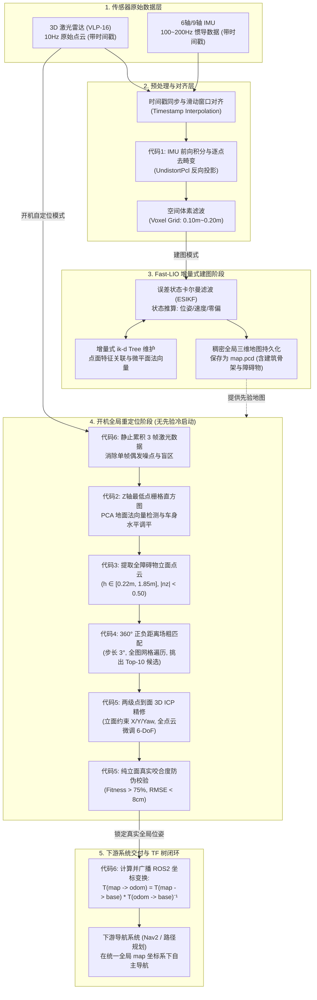

# 移动机器人 Fast-LIO 激光惯导建图与全局重定位技术方案（含核心代码级深入剖析）

---

## 1. 系统概述与整体架构

移动机器人在室内未知环境中实现自主作业，核心分为两大阶段：
1. **先验地图构建阶段（Mapping）**：利用 3D 激光雷达（LiDAR）与惯性测量单元（IMU）紧耦合，在移动过程中实时消除运动畸变、递推高精度位姿轨迹，并构建环境的稠密三维几何点云地图（`.pcd`）。
2. **开机全局重定位阶段（Global Relocalization）**：在机器人重新通电或冷启动时，在没有任何初始位姿先验输入（零初值、全图未知位置、未知航向角）的前提下，通过环境几何特征与先验地图匹配，计算出机器人在全局地图坐标系（`map`）下的绝对位姿 $(X, Y, Z, \text{Yaw}, \text{Pitch}, \text{Roll})$，建立 `map -> odom` 的坐标变换，使下游导航规划系统无缝工作。

---

## 2. 通用核心基础知识点详析

### 2.1 时间戳（Timestamp）与传感器时间对齐
* **概念定义**：时间戳是每个传感器数据包在采集或生成时打上的绝对时间标记（通常精确到纳秒或微秒）。
* **物理意义**：
  * **采样频率不对等**：激光雷达扫描通常为低频（如 10Hz，每隔 100ms 一帧），而 IMU 为高频（如 100Hz~200Hz，每隔 5~10ms 一个数据点）。
  * **对齐机制**：算法根据两个传感器数据包的时间戳，利用线性插值或积分，精确解算出任意激光点发射瞬间的 IMU 角速度与线加速度，从而完成时间域的数据融合。

### 2.2 激光雷达运动去畸变（Motion Undistortion / Deskewing）
* **畸变起因**：机械旋转式激光雷达（如 16 线 VLP-16）旋转一周耗时约 100ms。在此期间，小车若以 $1\text{ m/s}$ 的速度移动或发生旋转，雷达这一圈开始发射的点与最后发射的点并不是在同一个空间位置采样的，导致原本平直的墙面被拉扯成弧形或斜面（称为“果冻效应”或运动畸变）。
* **去畸变过程**：
  1. 读取雷达点云中每个点记录的微秒级相对时间偏移（Offset Time）。
  2. 结合该时间段内 IMU 高频积分推算的小车轨迹。
  3. 将每个激光打在物体上的点通过刚体变换插值，全部反向投影到“该帧雷达扫描结束时的统一坐标原点”，恢复物体真实的静态几何轮廓。

### 2.3 机器人坐标系体系与静态外参（TF & Extrinsic Calibration）
* **四大核心坐标系**：
  * **`lidar_link`（雷达系）**：以激光雷达发射中心为原点的局部三维坐标系。
  * **`base_link` / `body`（车体/IMU系）**：小车的几何运动中心（通常贴合 IMU 安装位置）。
  * **`odom`（里程计局部参考系）**：单次开机通电时以小车初始位置为原点的连续轨迹参考系，连续平滑但累积漂移、重新开机后归零。
  * **`map`（全局地图坐标系）**：整个实验室或作业场地的固定统一世界坐标系。
* **外参（Extrinsics）**：雷达和 IMU 在小车硬件上安装时的刚体相对位姿关系，包含三维平移向量 $\mathbf{p}_{imu}^{lidar}$ 与三维旋转矩阵 $\mathbf{R}_{imu}^{lidar}$。外参不准会导致算法将旋转误判为平移，造成定位发散。

### 2.4 空间体素网格滤波（Voxel Grid Downsampling）
* **原理**：将三维空间划分为大小均匀的立方体体素（如 $0.10\text{m} \times 0.10\text{m} \times 0.10\text{m}$ 网格），落入同一体素内的所有点被合并为一个重心点。在完整保留建筑几何骨架（拐角、平面、立柱）的前提下，过滤密集冗余点，计算量下降 70%~90%。

### 2.5 几何退化分析与地面/立面特征解耦（Ground Decoupling）
* **退化陷阱**：在室内平坦地面上，大面积的地面点云其表面法向量全部垂直指向天花板（$Z$ 轴）。沿 $X$ 或 $Y$ 平移运动时，地面点云的几何残差几乎为零，导致优化求解器在水平方向缺乏几何梯度，产生沿地面的虚假滑动（退化）。
* **解耦方案**：通过高程直方图与 PCA 自动解算基准地面高度，提取离地面特定高度区间（如 `h ∈ [0.22m, 1.85m]`）且法向量近乎水平（$|\mathbf{n}_z| < 0.5$）的点云，彻底剔除平坦地板，锁定实验台、矮柜、立柱、墙壁等对水平 $(X, Y, \text{Yaw})$ 提供强约束的特征。

### 2.6 点到面 ICP 配准算法原理（Point-to-Plane ICP）
* **原理**：相比朴素的点到点（Point-to-Point）ICP，点到面算法利用地图表面的局部平面切向量，只惩罚沿法向量垂直方向的穿透残差，收敛速度提高数倍且不易陷入微小凹凸的伪极小值：
  $$E(\mathbf{R}, \mathbf{t}) = \sum_{i} \left( \left(\mathbf{R}\mathbf{p}_i + \mathbf{t} - \mathbf{q}_i\right) \cdot \mathbf{n}_i \right)^2$$

---

## 3. 核心代码深入剖析

本节针对整个工程中最核心的 6 个底层代码段进行逐行解析，展示理论算法如何在 C++ 中工程落地。

### 💻 核心代码 1：IMU 运动积分与点云逐点去畸变（Deskewing）
* **源文件路径**：`fast_lio/src/IMU_Processing.hpp`
* **关键机制**：利用点云中每个点自带的时间戳微秒偏移（存于 `curvature` 字段），向后传播插值得到该瞬间的姿态，将每一个激光点逆向投影到帧尾瞬时雷达坐标系。

```cpp
// 摘自 fast_lio/src/IMU_Processing.hpp 中的 UndistortPcl 函数
auto it_pcl = pcl_out.points.end() - 1;
for (auto it_kp = IMUpose.end() - 1; it_kp != IMUpose.begin(); it_kp--)
{
    auto head = it_kp - 1;
    auto tail = it_kp;
    R_imu << MAT_FROM_ARRAY(head->rot);
    vel_imu << VEC_FROM_ARRAY(head->vel);
    pos_imu << VEC_FROM_ARRAY(head->pos);
    acc_imu << VEC_FROM_ARRAY(tail->acc);
    angvel_avr << VEC_FROM_ARRAY(tail->gyr);

    // 1. 根据当前激光点的时间戳偏移 (以毫秒存储在 curvature 字段中) 匹配对应的 IMU 积分区间
    for (; it_pcl->curvature / double(1000) > head->offset_time; it_pcl--)
    {
        // 计算当前点相对于 head IMU 时刻的微小时间间隔 dt
        double dt = it_pcl->curvature / double(1000) - head->offset_time;

        // 2. 李代数指数映射 (Exp) 增量积分，计算激光打在障碍物那一瞬间的局部旋转矩阵 R_i
        M3D R_i(R_imu * Exp(angvel_avr, dt));
        V3D P_i(it_pcl->x, it_pcl->y, it_pcl->z);

        // 3. 计算从该发射时刻到雷达帧尾时刻 (imu_state.pos) 的累计平移偏移量 T_ei
        V3D T_ei(pos_imu + vel_imu * dt + 0.5 * acc_imu * dt * dt - imu_state.pos);

        // 4. 应用外参 (offset_R_L_I / offset_T_L_I) 与车体姿态共轭变换，将点反向补偿到帧尾统一原点
        V3D P_compensate = imu_state.offset_R_L_I.conjugate() * 
            (imu_state.rot.conjugate() * (R_i * (imu_state.offset_R_L_I * P_i + imu_state.offset_T_L_I) + T_ei) 
             - imu_state.offset_T_L_I);

        // 覆盖为消除拉伸畸变后的真实静态三维空间坐标
        it_pcl->x = P_compensate(0);
        it_pcl->y = P_compensate(1);
        it_pcl->z = P_compensate(2);

        if (it_pcl == pcl_out.points.begin()) break;
    }
}
```

---

### 💻 核心代码 2：免调参自适应地面高程提取与 PCA 水平调平
* **源文件路径**：`open3d_loc/src/open3d_registration/global_matcher.cpp`
* **关键机制**：按 $25\text{cm} \times 25\text{cm}$ 网格取柱体最低点构建直方图，彻底消除 VLP-16 水平激光线在 $Z=0$ 的虚假偏置；利用协方差矩阵特征向量提取地面法向量以矫正车体倾角。

```cpp
// 摘自 global_matcher.cpp 中的 EstimateFloorAndLeveling 函数
// 1. 按 25cm x 25cm XY 栅格提取每个立柱的最低点 Z (免疫 0° 水平线偏置)
std::unordered_map<CellKey, double, CellHash> cell_min_z;
const double cell_w = 0.25;
for (const auto& p : cloud.points_) {
    double r2 = p.x() * p.x() + p.y() * p.y();
    if (r2 > 0.40 * 0.40 && r2 < 7.0 * 7.0 && p.z() >= -1.60 && p.z() <= 0.15) {
        int gx = static_cast<int>(std::floor(p.x() / cell_w));
        int gy = static_cast<int>(std::floor(p.y() / cell_w));
        auto it = cell_min_z.find({gx, gy});
        if (it == cell_min_z.end() || p.z() < it->second) {
            cell_min_z[{gx, gy}] = p.z();
        }
    }
}

// 2. 统计地面高程概率直方图，通过平滑卷积提取基准地面 Z
const double z_min = -1.60, bin_w = 0.04;
std::vector<int> hist(n_bins, 0);
for (const auto& kv : cell_min_z) {
    int b = static_cast<int>((kv.second - z_min) / bin_w);
    if (b >= 0 && b < n_bins) hist[b]++;
}
// 寻找三点平滑卷积响应最大的最高峰 bin，得到粗地面高程 z_rough

// 3. 提取地面附近内点，利用协方差矩阵与特征分解 (PCA) 估计地面法向量与车体水平调平矩阵 R_level
Eigen::SelfAdjointEigenSolver<Eigen::Matrix3d> es(cov);
Eigen::Vector3d normal = es.eigenvectors().col(0); // 最小特征值对应的特征向量即为法向量
if (normal.z() < 0) normal = -normal;

// 如果法向量与理论垂线偏差在 12° 以内，构造对齐旋转四元数消除倾角
if (normal.z() > std::cos(12.0 * M_PI / 180.0)) {
    R_level_out = Eigen::Quaterniond::FromTwoVectors(normal, Eigen::Vector3d::UnitZ()).toRotationMatrix();
}
```

---

### 💻 核心代码 3：全障碍物与纯立面点云特征提取
* **源文件路径**：`open3d_loc/src/open3d_registration/global_matcher.cpp`
* **关键机制**：截取距地面 `[0.22m, 1.85m]` 高度，筛选法向量水平分量占优的点（$|\mathbf{n}_z| < 0.50$），将法向量归一化投影至水平面，完整保留实验台和机柜立面。

```cpp
// 摘自 global_matcher.cpp 中的 ExtractVerticalWallCloud 函数
for (size_t i = 0; i < cloud_with_normals.points_.size(); ++i) {
    const auto& p = cloud_with_normals.points_[i];
    const auto& n = cloud_with_normals.normals_[i];
    if (!std::isfinite(p.x()) || !std::isfinite(p.y()) || !std::isfinite(p.z())) continue;
    
    // 计算当前点距基准地面的相对高度 h
    double h = p.z() - z_floor;
    
    // 高度在 [0.22m, 1.85m] 之间，且法向量垂直于地面 (|n.z| < 0.50，剔除桌面与地板)
    if (h >= min_height_above_floor && h <= max_height_above_floor &&
        std::isfinite(n.z()) && std::abs(n.z()) < max_abs_normal_z) {
        
        Eigen::Vector3d n_horiz(n.x(), n.y(), 0.0);
        double norm = n_horiz.norm();
        if (norm > 1e-3) {
            walls->points_.push_back(p);
            walls->normals_.push_back(n_horiz / norm); // 水平归一化法向量
        }
    }
}
```

---

### 💻 核心代码 4：360° 全局正负距离场并行粗匹配
* **源文件路径**：`open3d_loc/src/open3d_registration/global_matcher.cpp`
* **关键机制**：利用 OpenMP 对 120 个航向角（$3^\circ$ 步长）多线程并行旋转雷达点云，在预构建的 2D 距离场网格查找正负相关性得分，并做非极大值抑制（NMS）聚类出 Top-10 独立假设。

```cpp
// 摘自 global_matcher.cpp 中的 Relocalize 阶段一粗匹配循环
const int n_yaw = 120; // 360° / 3° = 120 组航向角
#pragma omp parallel for schedule(dynamic)
for (int a = 0; a < n_yaw; ++a) {
    double yaw = a * (2.0 * M_PI / n_yaw);
    float c = static_cast<float>(std::cos(yaw));
    float s = static_cast<float>(std::sin(yaw));

    // 1. 2D 平面刚体旋转点云坐标
    std::vector<Eigen::Vector2f> rot_pts(scan_sub.size());
    for (size_t i = 0; i < scan_sub.size(); ++i) {
        rot_pts[i] = Eigen::Vector2f(c * scan_sub[i].x() - s * scan_sub[i].y(),
                                     s * scan_sub[i].x() + c * scan_sub[i].y());
    }

    // 2. 遍历全图 2D 网格滑窗 (步长 20cm)
    for (int iy = 0; iy < ny; iy += stride) {
        float y_world = min_y + iy * df_.resolution;
        for (int ix = 0; ix < nx; ix += stride) {
            float x_world = min_x + ix * df_.resolution;
            float score = 0.0f;
            
            // 3. 累加正负距离场查表得分 (打在墙上为正高斯分，打在空地上为负惩罚分)
            for (const auto& pt : rot_pts) {
                int px = static_cast<int>((pt.x() + x_world - min_x) * inv_res);
                int py = static_cast<int>((pt.y() + y_world - min_y) * inv_res);
                if (px >= 0 && px < nx && py >= 0 && py < ny) {
                    score += lut_ptr[py * nx + px];
                } else {
                    score += out_of_bounds_penalty; // 出界强惩罚
                }
            }
            // 局部聚类提取每个角度响应最强的前 3 个极大值点
        }
    }
}
// 汇总后按空间距离 1.0m 进行 NMS 抑制，提取全局 Top-10 独立候选位姿
```

---

### 💻 核心代码 5：两级点到面 3D ICP 精修与纯墙面防伪校验
* **源文件路径**：`open3d_loc/src/open3d_registration/global_matcher.cpp`
* **关键机制**：先用纯立面点云消除地面干扰，通过点到面 ICP 精确约束 $(X, Y, \text{Yaw})$；再用全点云微调 6-DoF 位姿；最后计算纯立面点落在墙体邻域内的咬合比例（`wall_fitness`），从根本上避免对称误配。

```cpp
// 摘自 global_matcher.cpp 中的 Relocalize 阶段二多假设精修循环
#pragma omp parallel for schedule(dynamic)
for (size_t k = 0; k < top_k_cands.size(); ++k) {
    const auto& cand = top_k_cands[k];
    Eigen::Matrix4d T_init = ComputeTransform2D(cand.x, cand.y, cand.yaw);

    // 级别 1: 纯立面点到面 ICP (完全免疫地面几何退化，大范围搜索半径 0.75m -> 0.25m)
    auto icp_wall = open3d::pipelines::registration::RegistrationICP(
        *scan_walls_3d, *map_walls_, 0.25, T_init,
        open3d::pipelines::registration::TransformationEstimationPointToPlane(),
        open3d::pipelines::registration::ICPConvergenceCriteria(1e-6, 1e-6, 25));

    // 级别 2: 全点云 6-DoF 精修 (小半径 0.20m，结合地面高度锁定毫米级 Z / Roll / Pitch)
    auto icp_full = open3d::pipelines::registration::RegistrationICP(
        *scan_down, *map_down_, 0.20, icp_wall.transformation_,
        open3d::pipelines::registration::TransformationEstimationPointToPlane(),
        open3d::pipelines::registration::ICPConvergenceCriteria(1e-6, 1e-6, 25));

    // 级别 3: 严格评估纯垂直墙面与障碍物的真实几何咬合度 (阈值 0.20m)
    auto eval_wall = open3d::pipelines::registration::EvaluateRegistration(
        *scan_walls_3d, *map_walls_, 0.20, icp_full.transformation_);

    // 综合加权评分: 纯立面吻合度 (权重最大) - 墙面残差 + 粗匹配似然度
    hyp.wall_fitness = eval_wall.fitness_;
    hyp.wall_rmse = eval_wall.inlier_rmse_;
    hyp.composite_score = hyp.wall_fitness - 1.5 * hyp.wall_rmse + 0.25 * norm_coarse;
    refined_list[k] = hyp;
}
// 选出综合得分最高者，若 wall_fitness < 0.75 则判定重定位未通过并拒绝发布
```

---

### 💻 核心代码 6：ROS2 节点多帧累积、初值注入与 TF 树发布
* **源文件路径**：`open3d_loc/src/auto_global_reloc_node.cpp`
* **关键机制**：开机连续累积 3 帧激光数据消除单帧缺失；配准成功后构造 `PoseWithCovarianceStamped` 发布 `/initialpose`；计算并广播 `map -> odom` TF，实现导航系统无缝接管。

```cpp
// 摘自 auto_global_reloc_node.cpp 中的 pointcloud_callback 回调函数
*accumulated_scan_ += *o3d_scan;
frame_count_++;

// 1. 累积 3 帧确保静止环境下激光扫描充分覆盖
if (frame_count_ < accumulate_frames_) return;

// 2. 调用两阶段自定位核心算法
auto res = matcher_.Relocalize(accumulated_scan_);
if (!res.success) {
    RCLCPP_WARN(this->get_logger(), "纯墙面咬合度不足，清空缓存重新采集...");
    accumulated_scan_->Clear();
    frame_count_ = 0;
    return;
}

// 3. 构造 PoseWithCovarianceStamped 消息，连续发布 3 次供 Nav2 / AMCL 等订阅
geometry_msgs::msg::PoseWithCovarianceStamped pose_msg;
pose_msg.header.stamp = this->now();
pose_msg.header.frame_id = "map";
pose_msg.pose.pose.position.x = res.x;
pose_msg.pose.pose.position.y = res.y;
pose_msg.pose.pose.position.z = res.z;
pose_msg.pose.pose.orientation = tf2::toMsg(q_final);
pub_initialpose_->publish(pose_msg);

// 4. 计算并发布全局坐标变换 map -> odom (此处设 odom 原点与开机点重合)
latest_tf_.header.stamp = this->now();
latest_tf_.header.frame_id = "map";
latest_tf_.child_frame_id = "odom";
latest_tf_.transform.translation.x = res.x;
latest_tf_.transform.translation.y = res.y;
latest_tf_.transform.translation.z = res.z;
latest_tf_.transform.rotation = tf2::toMsg(q_final);
tf_broadcaster_->sendTransform(latest_tf_);
```

---

## 4. 端到端完整系统数据流图



---

## 5. 核心参数与调试工程经验对照表

| 模块 | 核心参数/指标 | 对应代码位置 | 推荐经验值 | 作用与物理含义 |
| :--- | :--- | :--- | :--- | :--- |
| **Fast-LIO** | `filter_size_surf` | `laserMapping.cpp` | `0.15 m` ~ `0.20 m` | 点云下采样分辨率，越小精度越高但 CPU 负载越重 |
| **Fast-LIO** | `extrinsic_T / R` | `IMU_Processing.hpp` | 实测标定矩阵 | 雷达到 IMU 的刚体外参，直接决定运动预测精度 |
| **全局重定位** | `z_floor` | `global_matcher.cpp` | `≈ -0.45 m`（自动解算） | 地面高度基准，通过网格最低点直方图免调参自适应 |
| **全局重定位** | `min_h ~ max_h` | `global_matcher.cpp` | `0.22 m ~ 1.85 m` | 垂直立面切片高度范围，既剥离平整地面，又完整覆盖实验台与墙壁 |
| **全局重定位** | `n_yaw` (粗匹配) | `global_matcher.cpp` | `120` (每 $3^\circ$ 一格) | 360° 旋转采样网格密度，保证不漏掉正确朝向的峰值 |
| **全局重定位** | `Wall Fitness` 门槛 | `global_matcher.cpp` | `≥ 75.0%` | 真实立面咬合率，有效鉴别并拒绝假匹配（误匹配通常低于 50%） |
| **ROS2 TF** | 变换关系 | `auto_global_reloc_node.cpp` | `map -> odom` | 保持 `odom -> base_link` 连续平滑无跳变，跳变由 `map -> odom` 吸收 |
